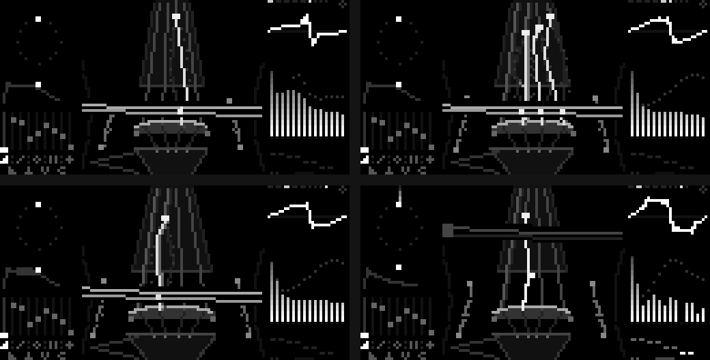
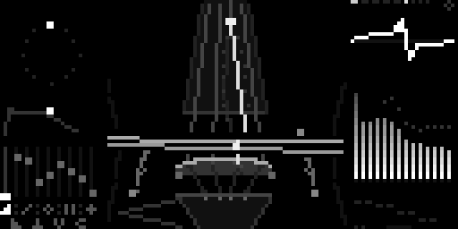
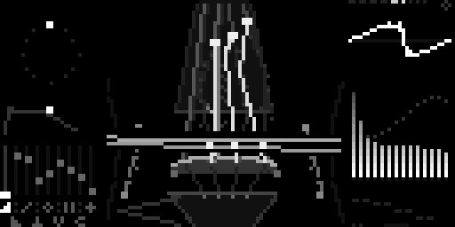
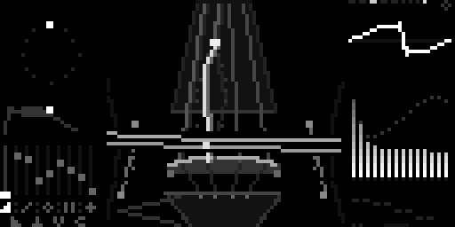
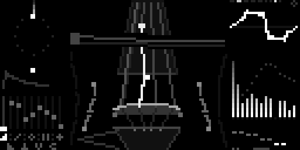
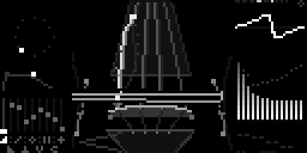

[English](README.md) · [Español](README.es.md) · **Français** · [Deutsch](README.de.md) · [日本語](README.ja.md) · [中文](README.zh.md) · [हिन्दी](README.hi.md)

# ChordexSTG

Un pupitre de cordes d'orchestre pour [monome norns](https://monome.org/docs/norns/) :
une touche joue un accord de quatre notes (plus la basse), frotté par des
violons, des altos, des violoncelles, des contrebasses ou tout l'orchestre.



**L'écran est l'instrument.** Au centre, on voit les quatre cordes de face, de
la touche au chevalet, avec les ouïes sur les côtés. Chaque note de l'accord
vibre sur sa corde avec le mouvement réel d'une corde frottée (mouvement de
Helmholtz : un angle qui court entre le doigt et le chevalet). Le doigt
indique où la note est appuyée et oscille avec le vibrato. L'archet traverse
les cordes : sa hauteur est le timbre (en haut sul tasto, en bas sul
ponticello) et sa vitesse la nuance. Il rebondit en spiccato, tremble en
trémolo et se lève en pizzicato. La poussière de colophane montre la
pression ; les étincelles qui montent, le « ciel ».

- à gauche : l'accord sur une roue de 12 notes, l'enveloppe de l'articulation
  et les 9 faders
- à droite : oscilloscope, harmoniques avec la courbe de résonance de la
  caisse, motif de l'arpège ; en haut, pupitre, articulation et maintien
- en bas à gauche : le soufflet (<) de la nuance

## Fonctions

- **5 pupitres**, chacun dans son registre et avec sa propre caisse : VIOLIN
  (une octave au-dessus), VIOLA, CELLO (une octave en dessous), CONTRABAJO
  (deux octaves en dessous) et **TUTTI**, qui répartit l'accord dans tout
  l'orchestre, placé comme sur scène
- **4 articulations** : legato, spiccato, pizzicato, trémolo — pour les
  accords et les arpèges
- **12 accords** : maj, min, dim, aug, 7, maj7, min7, m7b5, sus2, sus4, 5, add9
- **arpégiateur** : up, down, up-down, up x2, down x2, random et *arpa*
  (harpe) ; gate au maximum = vrai legato, l'archet glisse de note en note
- **mode accord** on/off (off = notes seules) et **maintien**
- craquement de vieux disque avec plus de deux touches enfoncées
- suit l'horloge MIDI entrante pour le tempo de l'arpège
- tous les réglages sont sauvegardés automatiquement

<!-- u-ma:family -->
## La famille Chordex

Mêmes contrôles, moteurs différents. Essayez les autres :

| | |
|---|---|
| <a href="https://github.com/buenosairesfront/chordex80/blob/main/README.fr.md"></a> | **[Chordex 80](https://github.com/buenosairesfront/chordex80/blob/main/README.fr.md)**<br>polysynthé des années 80 avec un coucher de soleil outrun<br>`;install https://github.com/buenosairesfront/chordex80` |
| <a href="https://github.com/buenosairesfront/chordexfm/blob/main/README.fr.md"></a> | **[Chordex FM](https://github.com/buenosairesfront/chordexfm/blob/main/README.fr.md)**<br>FM à 4 opérateurs, dessinée comme une fleur<br>`;install https://github.com/buenosairesfront/chordexfm` |
| <a href="https://github.com/buenosairesfront/chordexwt/blob/main/README.fr.md"></a> | **[Chordex WT](https://github.com/buenosairesfront/chordexwt/blob/main/README.fr.md)**<br>wavetable : 8 banques de 8 ondes, dessinée comme une table en 3D<br>`;install https://github.com/buenosairesfront/chordexwt` |

**Plus de U-MA :** tous les instruments et outils au même endroit → [vitrine U-MA](https://github.com/buenosairesfront/U-ma/blob/main/README.fr.md)
<!-- /u-ma:family -->

## Prérequis

- norns (shield, standard ou fates)
- un clavier ou contrôleur MIDI

## Installation

Depuis maiden :

```
;install https://github.com/buenosairesfront/chordexstg
```

Ensuite **redémarrez norns** (SYSTEM > RESTART) pour compiler le nouveau
moteur `ChordexSTG`, puis chargez **chordexstg** depuis SELECT.

## Contrôles

| contrôle | action |
|---|---|
| E1 | nuance (pp … ff) |
| E2 | choisir un fader |
| E3 | régler le fader |
| K3 + E1 | pupitre |
| K3 + E2 | articulation |
| K3 + E3 | type d'accord |
| K2 (appui bref) | arpégiateur on/off |
| K2 + E1 | gate de l'arpège (max = legato) |
| K2 + E2 | motif de l'arpège |
| K2 + E3 | vitesse de l'arpège |
| K3 maintenu (sans tourner) | mode accord on/off |
| K1 maintenu | maintien on/off (petit losange en haut à droite) |

**Faders :** attaque, relâchement, timbre, pression de l'archet, vibrato,
vitesse du vibrato, ensemble, swell (crescendo), ciel.

**Menu PARAMETERS :** canal MIDI (0 = tous, par défaut), diviseur d'horloge
MIDI, octave, niveau de basse, salle, volume, et tout ce qui précède.

## Galerie

| | |
|---|---|
|  violon · legato |  tutti |
|  violoncelle · trémolo |  alto · pizzicato · arpège |
|  contrebasse | |

## Crédits

Créé par [Buenos Aires Front](https://github.com/buenosairesfront) / U-MA,
de la famille U-MA / Chordex. Licence MIT.
